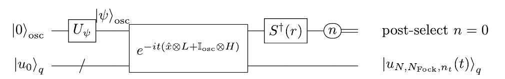

Our paper **"Gate-level quantum simulation of nonunitary linear dynamics with hybrid oscillator–qubit architecture"** is out in *Quantum Science and Technology*, open access. It is joint work with Muqing Zheng, Rishab Dutta, Ang Li, Timothy Stavenger (Pacific Northwest National Laboratory), and Yuan Liu (NC State).

📄 **Paper:** [Quantum Sci. Technol. 11, 045046 (2026)](https://doi.org/10.1088/2058-9565/aea2c6)
💻 **Code and data:** [github.com/Firepanda415/CV-DV-LCHS](https://github.com/Firepanda415/CV-DV-LCHS)

## The problem: quantum computers are unitary, most physics is not

Many problems in science and engineering come down to linear differential equations, du/dt = −(L + iH)u. Heat flow, diffusion, damped oscillators, and discretized PDEs all fit this form. The Hermitian part L ⪰ 0 adds dissipation, so the evolution is **not unitary**, and a quantum computer cannot run it directly.

**Linear combination of Hamiltonian simulation (LCHS)** gets around this. It writes the nonunitary evolution as an integral over ordinary Hamiltonian simulations, weighted by a kernel g(x). On a qubit-only (discrete-variable, DV) machine, that integral has to be discretized into Ma quadrature points. This needs an ancilla register of O(log Ma) qubits and a careful circuit to load the weights.

## The idea: let an oscillator carry the integral

The integration variable x is continuous, and so is the position quadrature of a harmonic oscillator, such as a microwave cavity or a photonic mode. In a **hybrid oscillator–qubit (CV–DV)** architecture, a single ancillary oscillator can represent the whole continuous integral, with no discretization.

*Figure 1 of the paper (CC BY 4.0). Prepare an oscillator state |ψ⟩, evolve jointly under x̂ ⊗ L + 𝕀 ⊗ H, apply inverse squeezing, and postselect the oscillator on vacuum. The qubit register then holds the nonunitary evolved state.*

The circuit has three steps:

1. **Prepare** a non-Gaussian oscillator state |ψ⟩ that encodes the LCHS kernel.
2. **Evolve** the oscillator and the qubit register together under the hybrid generator x̂ ⊗ L + 𝕀 ⊗ H.
3. **Postselect** on a squeezed vacuum by applying S†(r) and keeping only the n = 0 outcome.

The overlap of the prepared state and the postselected state reproduces the kernel g(x), so the qubit register is left in e−At|u₀⟩. The one-mode dilation behind this is shared with Schrödingerization and qumodization. Our contribution is a **finite-resource, gate-level realization** of it, together with a block-by-block account of where the errors come from.

## Error analysis, block by block

In a real device the oscillator state has finite energy and the simulation runs at finite depth, so we bound each source of error separately.

- **Kernel encoding.** We write the oscillator state as a truncated squeezed-Fock expansion with cutoff N. The projection error decays **superalgebraically** in N for Schwartz-class kernels, and at a stretched-exponential rate under stronger assumptions.
- **Non-Gaussianity.** The truncated kernel state generically has **stellar rank N − 1**, so N also measures the oracle's non-Gaussian resource.
- **Hybrid Trotterization.** A p-th-order product formula needs O(t1+1/p NFock(p+1)/(2p) ε−1/p) steps in the worst case, where NFock is the oscillator dimension.
- **Postselection.** A perturbation bound ties the total map error to the physical success probability, so one error budget controls both accuracy and sampling overhead.

## Building the circuits

We compile the full algorithm to gates:

- **State preparation** uses two routes: Law–Eberly synthesis with Jaynes–Cummings pulses and qubit rotations, and a variational SNAP + displacement sequence.
- **Hybrid evolution** breaks into Pauli rotations on the qubits plus a single kind of hybrid gate, e−iθ x̂ Z, reached through basis changes and CX parity ladders.

Everything is simulated at the circuit level in Bosonic Qiskit.

## Results

We tested the method on heat equations with Dirichlet, Neumann, and periodic boundary conditions, on larger 1D grids, on a 2D heat stress case, and on **non-normal advection–diffusion** generators.

- For 1D heat and advection–diffusion up to D = 32, the circuit-level **fixed-scale map error is at most 1.48%** and the conditional infidelity is at most **4.68 × 10⁻⁴**, over all computational-basis inputs.
- The 4 × 4 2D stress case reaches 7.40% error, mostly because stronger 2D damping shrinks the solution norm.
- Compared with a DV LCHS baseline at its prescribed sizing, **one oscillator mode replaces an 8–10-qubit quadrature register**, and the hybrid route has the **smaller error in all ten instances**.
- The tradeoff is postselection: the DV route needs fewer repetitions in every instance. The hybrid route also relies on oscillator state preparation and displacement operations, which have no standard CX-equivalent cost.
- A bounded photon-loss model shows how oscillator loss before the evolution degrades the output and the success probability.

## Takeaway

When the quadrature register is the main cost of LCHS, a single continuous oscillator mode is a practical alternative to qubit-only implementations, and every part of its error budget is accounted for. Next steps include device-calibrated noise, logical (error-corrected) oscillator encodings, the newer optimal LCHS kernels, and nonlinear PDEs through Carleman linearization.

I presented this work as a poster at the IEEE QCE 2026 SIPQ workshop in Toronto. Many thanks to my coauthors and collaborators at PNNL, and to Kaustubh Chandramouli for helpful discussions.

**Citation:** E. R. Das, M. Zheng, R. Dutta, A. Li, T. Stavenger, and Y. Liu, *Gate-level quantum simulation of nonunitary linear dynamics with hybrid oscillator–qubit architecture*, Quantum Sci. Technol. **11**, 045046 (2026). [doi:10.1088/2058-9565/aea2c6](https://doi.org/10.1088/2058-9565/aea2c6)
