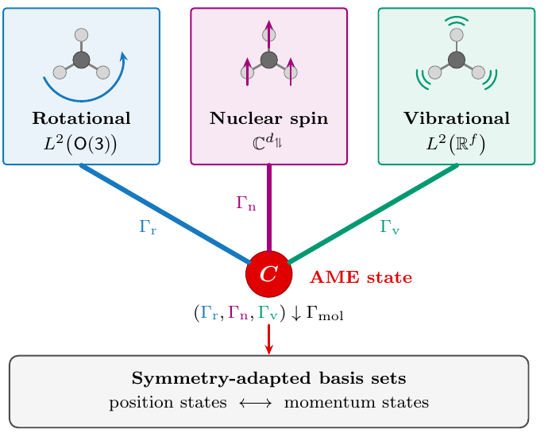

I'm excited to share our latest preprint, **"Symmetry classification of hyperfine rovibrational molecular phase space,"** with Jing-Chen Zhang, Victor V. Albert, and Yuan Liu.

📄 **arXiv:** [2611.23406](https://arxiv.org/abs/2611.23406)

This paper comes out of my broader project, *Quantum Theory of Molecular Phase Space*, which I started in September 2024. After more than two years on it, I'm excited (and a bit relieved) to share this first result.

*Figure 1 of the paper. The rotational (blue), nuclear-spin (magenta), and vibrational (green) sectors of a pyramidal XH₃ molecule are bound by a coupling tensor C that symmetry fixes. Every such tensor is an absolutely maximally entangled state.*

## Two fields, one molecule

Chemical physics and quantum information science look at molecules in very different ways.

- **Spectroscopy** uses molecular symmetry to decide which combinations of rotational, vibrational, and nuclear-spin quantum numbers are allowed. Symmetry explains selection rules, nuclear-spin statistical weights, and missing spectral lines.
- **Quantum information** usually picks out a small part of a molecule to use as a qubit or qudit register. It does not use the full molecular Hilbert space, and it leaves out the global symmetry constraints that tie the degrees of freedom together.

Our question was what happens when you treat all three degrees of freedom together, symmetry constraints included, as one quantum state space.

## A phase space for the whole molecule

A phase space here means a configuration manifold with two Fourier-conjugate bases on it: **position states** (localized orientations and normal-mode displacements) and **momentum states** (angular-momentum and occupation-number states, the ones spectroscopy measures).

For a molecule, the configuration manifold is the set of orientations together with the normal coordinates, divided by the molecule's point group *G*. Nuclear spin adds a finite internal space at each point. The quotient cannot be taken one sector at a time, because a symmetry operation that permutes identical nuclei acts on the orientation and the vibrations together. Earlier work by Albert and collaborators built this phase space for rotation and nuclear spin only, with vibration left out. Including vibration matters for degenerate modes and overtones, which carry nontrivial irreps.

## Symmetry gives maximal entanglement

Identical-particle statistics picks out the allowed **molecular species**. Each species is a triple of irreps describing how rotation, nuclear spin, and vibration transform. Within a species, the physical states factor into:

1. **multiplicity spaces**, which symmetry leaves free and the Hamiltonian fills in, and
2. a **coupling tensor** joining the three sectors, which symmetry fixes (uniquely, for most point groups).

The main result is that **every coupling tensor is an absolutely maximally entangled (AME) state**: it has the most entanglement its dimensions allow across every cut between one sector and the other two. This follows from symmetry alone and holds for any Hamiltonian. Interactions can mix species, but each species keeps its AME state.

Up to local unitaries and the order of the sectors, the coupling tensors of the 75 point groups realize **21 distinct AME states**:

- 1 product state,
- 4 maximally entangled pairs, and
- 16 genuinely tripartite states.

Some examples: **phosphine** (PH₃) and **calcium monomethoxide** (CaOCH₃) host a three-qubit GHZ-type state at definite parity, and **methane** (CH₄) hosts a totally antisymmetric three-qutrit state. All seven AME states that occur outside the icosahedral groups already show up in methane.

A Fourier transform on the reduced configuration space connects the orientation picture and the angular-momentum picture, and it preserves these coupling tensors.

## Checking against real molecules

We tested the framework on **H₂O, PH₃, CH₄**, and the laser-coolable symmetric top **CaOCH₃**. It reproduces the known nuclear-spin statistical weights, the species-resolved rotational selection rules, and vibrationally induced species interchange. In water, for example, the antisymmetric stretch swaps which rotational species go with a given nuclear-spin species. For each molecule we write every allowed sector explicitly in both position and momentum form.

Because the coupling tensor depends only on symmetry, the framework tells you ahead of time the space where every eigenvector from a variational code (TROVE, DVR3D, MULTIMODE, GENIUSH, ...) must lie, and what structure it must have. The Hamiltonian only sets the amplitudes in the multiplicity spaces.

## Toward experiments

We also propose an experimental protocol for CaOCH₃. Using its doubly degenerate Ca–O–C bending mode (about 144 cm⁻¹), it prepares and drives symmetry-adapted bend states: arbitrary superpositions of four molecular levels whose bend parts are built from symmetry-adapted combinations with three vibrational quanta. Both proton-spin isomers of CaOCH₃ have already been laser-cooled, so it is a realistic platform.

## Why it matters for quantum information

Molecular symmetry is not only a constraint on quantum information processing. It can also supply **structured multipartite entanglement**. The carrier dimensions and coupling multiplicities give a natural way to organize molecular qudit encodings. The two-dimensional coupling spaces are each a pure distance-two code on the three carriers, which makes them candidates for protected encodings. We will treat encoding and control in detail in a companion paper.

## Open resources

We released two repositories so others can explore and reproduce the results:

- 🔹 **[Point Group Atlas](https://github.com/valbert4/point-group-atlas)**: a reference for 91 finite and seven continuous point groups. It covers exact symmetry data, representation theory, Clebsch–Gordan coefficients, subgroup structure, invariant tensors, and symmetry-adapted bases.
- 🔹 **[Molecular Entanglement Zoo](https://github.com/QUESTLiu/molecular-entanglement-zoo)**: the symmetry-derived molecular entanglement structures and species classifications from the paper, along with the code that generates and checks them and the ab initio inputs and outputs for CaOCH₃.

I'm deeply grateful to Jing-Chen Zhang, Victor V. Albert, and Yuan Liu for their collaboration throughout this work. Questions and comments are very welcome.

**Paper:** E. R. Das, J.-C. Zhang, V. V. Albert, and Y. Liu, *Symmetry classification of hyperfine rovibrational molecular phase space*, [arXiv:2611.23406](https://arxiv.org/abs/2611.23406) (2026).
